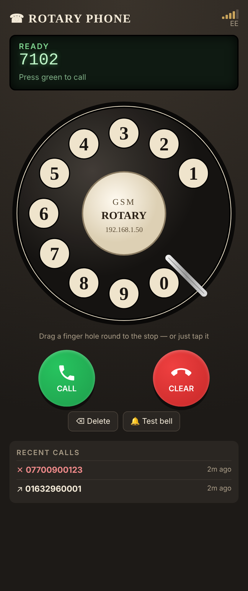

# RotaryPhone – a BT rotary telephone on the GSM network

An ESP32-S3 and a SIM900 GSM module turn a classic BT/GPO rotary phone (746 or similar) into a working mobile phone:

- **Lift the handset** to hear dial tone. **Dial** on the real rotary dial; the call goes out automatically.
- **Incoming calls ring the real bell** at 25 Hz with the UK double-ring cadence (0.4 s on, 0.2 s off, 0.4 s on, 2 s off). The bell is driven at 12 V through a stepper driver.
- **Lift the handset to answer.** Put it down to hang up. Speech uses the handset's earpiece and mic.
- **Web page** (`http://rotaryphone.local`) with an animated rotary dial, a **green** call/answer button, a **red** hang-up button, signal strength, caller ID and recent calls.
- Turning the dial during a call sends DTMF tones, so you can use phone menus ("press 1 for…").



## Files

| File | What it is |
|---|---|
| `RotaryPhone.ino` | Main sketch: modem control, dial decoding, bell, hook switch, web API |
| `config.h` | **Edit this first**: WiFi, web login, pins, bell driver type, volumes |
| `webpage.h` | The web interface (HTML/CSS/JS stored in flash) |

## Building

1. Arduino IDE → Boards Manager → install **esp32 by Espressif** (2.x or 3.x).
2. Board: **ESP32S3 Dev Module**. Set USB CDC On Boot to *Enabled* so serial logs appear over USB.
3. Edit `config.h` (WiFi name/password, web login, SIM PIN), then upload.
4. Open the Serial Monitor at 115200 baud to watch the `[SIM<]`, `[DIAL]` and `[STATE]` logs.

No extra libraries are needed.

If the phone can't join your WiFi, it starts its own access point, **RotaryPhone** (password `ringring123`). The web page is then at `http://192.168.4.1`.

## Wiring

```
                 12 V PSU (3 A)
                    │
          ┌─────────┼───────────────────────────┐
          │         │                           │
     Buck → 5 V   Buck → 4.0–5 V (2 A peaks!)   Stepper driver VMOT
          │         │                           │
     ESP32-S3 5V  SIM900 board VIN              │
                                                │
ESP32-S3                 SIM900 board           │   A4988 / DRV8825
────────                 ────────────           │   ───────────────
GPIO17 (TX) ───────────► RXD                    └── VMOT (+100 µF cap)
GPIO18 (RX) ◄─────────── TXD                        GND ── common GND
GPIO16      ───────────► PWRKEY / D9            GPIO7  ─► STEP
GND ──────────────────── GND                    GPIO15 ─► DIR
                                                GPIO8  ─► EN (active low)
Phone                                           3V3    ─► RESET + SLEEP (tie together)
─────                                           1A/1B  ─► bell coils (in series)
Hook switch   GPIO4 ── switch ── GND             MS1-3  left open (full step)
Dial pulse    GPIO5 ── contact ── GND
Dial off-norm GPIO6 ── contact ── GND  (optional, set -1 if not used)

Handset receiver  ── SIM900 SPK1P / SPK1N  (or the shield's speaker jack)
Handset mic       ── SIM900 MIC1P / MIC1N  (or the shield's mic jack)
```

**Common ground:** the ESP32, SIM900, stepper driver and 12 V supply must all share GND.

**Logic levels:** the ESP32 runs at 3.3 V. Most SIM900 shields have a level shifter or accept 3.3 V on RXD. If yours outputs 5 V on TXD, put a divider (e.g. 10 k / 20 k) on the line into GPIO18.

**SIM900 power:** the module draws current spikes of up to 2 A while transmitting. A weak supply makes it reset mid-call. Give it its own buck converter and a large capacitor (1000 µF or more) close to the module. Don't power it from the ESP32's 5 V pin.

### Bell (12 V via a stepper driver)

The BT bell is a polarised ringer: two coils on a permanent magnet. Reversing the current 25 times a second swings the clapper between the two gongs.

- **A4988 / DRV8825 (default, `BELL_DRIVER BELL_STEPDIR`):** in full-step mode, winding A reverses polarity every 2 steps. The sketch steps at 100 steps/s while ringing, which gives exactly 25 Hz on winding A. Connect the bell coils across **1A/1B** and leave 2A/2B unconnected. The driver is disabled between rings, so nothing heats up.
- **L298N / TB6612 / DRV8871 (`BELL_DRIVER BELL_HBRIDGE`):** IN1 = GPIO7, IN2 = GPIO15, ENA = GPIO8. Bell coils go across OUT1/OUT2.
- **Disconnect the bell from the phone's original circuit.** Remove the ringer capacitor from its path and wire the coils straight to the driver.
- These bells were designed for about 75 V AC. At 12 V the ring can be softer:
  - Adjust the bell's clapper/armature bias screw.
  - Check the two coils are wired in series with the correct polarity (if they oppose each other, the bell barely moves).
  - Or raise VMOT. A4988 and L298N accept up to 35 V; DRV8825 up to 45 V.
- Press **🔔 Test bell** on the web page to ring for 6 seconds while you adjust.

### Rotary dial

Use a multimeter to find:

- **Pulse contacts:** closed at rest, open briefly once per pulse. One pulse for "1", ten for "0".
- **Off-normal contacts:** change state whenever the dial is away from rest. If these are wired, digits are detected more reliably. If not, set `PIN_DIAL_OFFNORMAL -1`; the sketch then ends each digit after a 250 ms pause.

If your contacts behave the other way round, flip `DIAL_PULSE_BREAK_LEVEL` / `DIAL_OFFNORMAL_ACTIVE` in `config.h`. Do the same with `HOOK_OFF_LEVEL` for the hook switch.

### Handset audio (mic and speaker)

Wire the handset cord **straight to the SIM900**. Bypass the phone's original network/induction coil (the anti-sidetone circuit); it's designed for a 50 V line and will just mute things.

- **Receiver (earpiece):** the rocking-armature receiver works fine on the SIM900's differential SPK1P/SPK1N output. Set the volume with `SPEAKER_VOLUME`.
- **Transmitter (mic):** the original **carbon** microphone won't work well, because it needs a DC bias current the SIM900 doesn't supply. Replace it with an **electret capsule**, either fitted inside the old transmitter cup or as a ready-made "electret transmitter inset" replacement. The SIM900's MIC1 input powers an electret directly. Watch the polarity: the capsule's ground leg goes to MIC1N. Set the gain with `MIC_GAIN`.
- If the person you're talking to hears an echo, lower `MIC_GAIN`/`SPEAKER_VOLUME`, or look up `AT+ECHO` in the SIM900 AT manual.

## Testing from the Serial Monitor

Open **Tools → Serial Monitor**, set it to **115200 baud** and **Newline**, and type `help`. You can test each part of the phone on its own before it's all assembled:

| Command | What it tests |
|---|---|
| `status` | Phone state, handset, SIM900, signal, WiFi address and pin levels |
| `watch on` | Prints every change on the hook / dial pins. Lift the handset and turn the dial to check the wiring |
| `bell` / `bell on` / `bell off` | Rings the bell (6 s burst, or continuously) so you can adjust it |
| `lift` / `hangup` / `hook real` | Pretends the handset is lifted or put down, without the hook switch wired |
| `digit 7` | Pretends a digit was dialled |
| `ring` | Fake incoming call: rings the bell, `lift` or `end` stops it |
| `call 07700900123` / `answer` / `end` | Real calls through the SIM900 |
| `dtmf 123#` | Sends tones during a call |
| `AT+CSQ` (anything starting `AT`) | Sent straight to the SIM900 so you can try AT commands |
| `signal` | Signal strength, registration and network name |
| `tone dial` / `busy` / `nu` / `off` | Plays a tone in the earpiece |
| `vol 80` / `mic 10` | Adjusts earpiece volume and mic gain live |
| `sim off` / `sim on` | Hides or shows the modem traffic |
| `simreset` | Power-cycles and re-initialises the SIM900 |
| `log` / `reboot` | Recent calls / restart |

When the dial is wired correctly, dialling a 5 prints `[DIAL] 5`.

## How calls behave

| You do | Result |
|---|---|
| Lift handset | Dial tone (from the SIM900, `AT+STTONE`) |
| Dial 999 / 112 | Calls immediately |
| Dial an 11-digit number starting with 0 | Calls as soon as the last digit is dialled |
| Dial anything else (00 international, short codes) | Calls 4 s after your last digit |
| Leave handset off without dialling for 30 s | Number-unobtainable tone, like a real exchange |
| Other end hangs up | Engaged/unobtainable tone until you replace the handset |
| Incoming call | Bell rings with the UK cadence; caller ID shows on the web page |
| Lift handset while ringing | Answers |
| Incoming call while you have the handset off | Rejected (caller hears engaged) |

**From the web page**

- Dial by dragging a finger hole round to the metal stop, by tapping a hole, or by typing digits on the keyboard.
- **Green** calls the number on the display (Enter key), or answers when the phone is ringing.
- **Red** hangs up or rejects a call (Esc key). When no call is in progress, it clears the display.
- Click a recent call to put that number back on the display.
- Speech always goes through the handset. If you start a call from the web page, lift the handset to talk.

## Notes

- **2G network:** the SIM900 is a **2G-only** module. UK networks have already switched off 3G and plan to switch off 2G by 2033, so check that your SIM's network still has 2G coverage where you live. If it doesn't, a 4G module with voice (VoLTE) is needed instead, such as a SIM7600E or A7670E. Their AT commands are very similar (`ATD`, `ATA`, `ATH`, `+CLCC`, `+CLIP`), so most of this sketch carries over. Only the audio/tone commands (`AT+CHFA`, `AT+CMIC`, `AT+STTONE`) would need checking.
- **Tone sounds:** `AT+STTONE` dial and busy tones are the SIM900's built-in tones, which sound close to, but not exactly like, BT's 350+450 Hz tones. Set `USE_SIM_TONES 0` if your firmware doesn't support the command.
- **Web login:** the web page is protected by the login in `config.h`, so other people on your WiFi can't make calls on your SIM. Change the default password.
