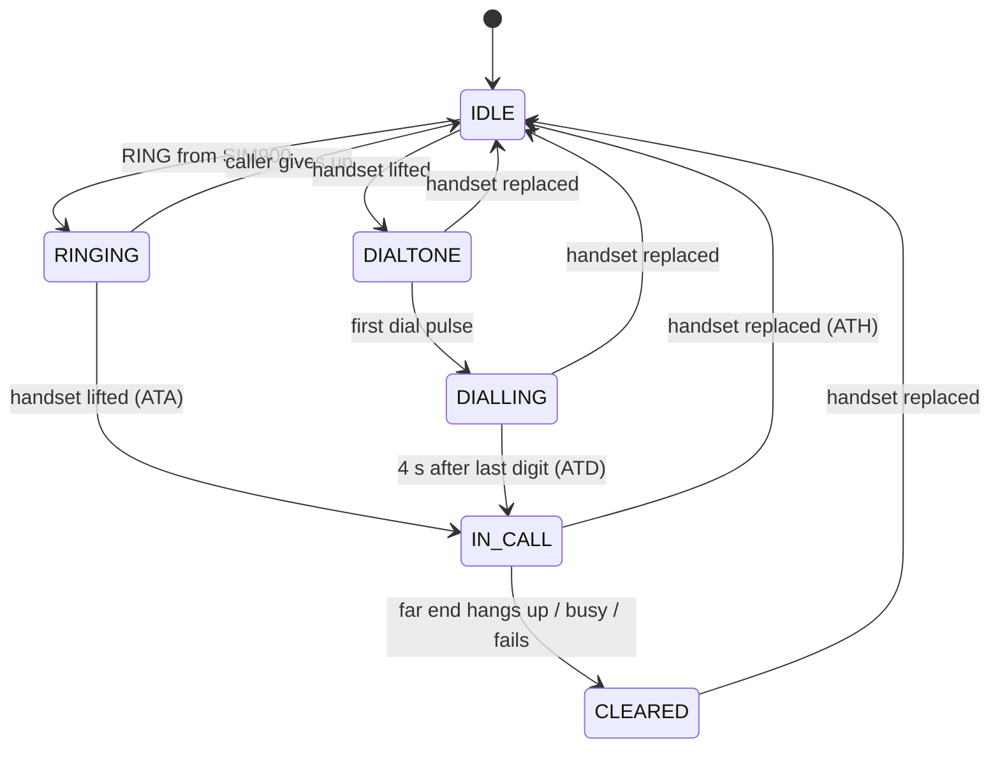

# BT Rotary GSM Phone ☎️

Bring an old BT / GPO rotary dial telephone back to life as a fully working mobile phone. An Arduino Uno reads the original rotary dial and hook switch, a SIM900 GSM module makes and receives the calls, and an L293D motor shield rings the phone's original mechanical bell with the proper British ring cadence. Lift the handset and you hear genuine BT dial tone; dial a number and it rings out over the mobile network. The whole thing runs from a 12 V rechargeable battery, so the phone needs no landline at all.

## ESP32-S3 version with web interface

There is also an **ESP32-S3** version in [`ESP32-S3/RotaryPhone`](ESP32-S3/RotaryPhone). It adds a WiFi web page with an animated rotary dial, a green call/answer button and a red hang-up button. It also shows caller ID, signal strength and recent calls. The bell is driven at 12 V through an A4988/DRV8825 stepper driver or an L298N-style H-bridge. See [its README](ESP32-S3/RotaryPhone/README.md) for wiring and setup.

## Features

| Action | What happens |
|---|---|
| Lift handset | BT dial tone (350 Hz + 440 Hz) plays in the earpiece |
| Turn the dial | Dial tone stops; pulses are counted into digits (10 pulses = 0) |
| Stop dialling for 4 s | Number is dialled through the SIM900 |
| Dial 999 or 112 | Dialled immediately after the third digit |
| Dial during a call | Digits are sent as DTMF tones (for "press 1 for…" menus) |
| Replace handset | Call is hung up |
| Incoming call | Bell rings with the UK cadence: 0.4 s on, 0.2 s off, 0.4 s on, 2.0 s off, at 25 Hz |
| Lift handset while ringing | Call is answered |
| Off-hook when a call arrives | Caller gets engaged |
| Other end hangs up / is busy | BT busy tone (400 Hz, 0.375 s on/off) |
| Call fails, no network, or left off-hook 30 s | BT number unobtainable tone (400 Hz continuous) |

## Parts

1. Arduino Uno
2. SIM900 GSM module or shield (with a 2G-capable SIM; check your network still supports 2G)
3. L293D motor / stepper shield (Adafruit v1 compatible, uses the `AFMotor` library)
4. BT / GPO rotary telephone (706, 746, 8746 or similar)
5. 12 V rechargeable battery (SLA or Li-ion pack with BMS)
6. 12 V → 5 V buck converter rated 3 A (for the SIM900)
7. Electret microphone capsule (to replace the carbon transmitter)
8. Optional: LM386 audio amplifier module for a louder earpiece
9. Resistors and capacitors for the tone filter: 2 × 1 kΩ, 2 × 100 nF, 10 µF, 10 kΩ

## How it works

The sketch is a non-blocking state machine, so the bell, tones, dial and GSM module are all serviced continuously.



**Rotary dial.** The dial's pulse contacts are normally closed and open once per pulse (about 10 pulses per second). The Arduino debounces them, counts each break, and treats a 250 ms gap as the end of a digit.

**Tones.** Timer1 runs a 10-bit fast PWM at 15.6 kHz on pin 10 and a two-oscillator DDS interrupt sums two sine waves, giving authentic dual-frequency BT dial tone. A two-stage RC filter removes the PWM carrier.

**Bell.** The L293D drives the bell at 25 Hz. In the default two-coil mode the first half of each cycle energises coil A on M1 and the second half energises coil B on M2. A bridge mode is also available that puts both coils in series on M1 and reverses polarity every half cycle.

## Wiring

> ⚠️ **Do not stack the SIM900 shield on the L293D shield.** The motor shield uses D3, D4, D5, D6, D7, D8, D11 and D12, and most SIM900 shields use D7/D8 for serial. Mount the motor shield on the Uno and connect the SIM900 with jumper leads.

### Arduino / shield connections

| Arduino pin | Connects to | Notes |
|---|---|---|
| A0 | SIM900 TX | SoftwareSerial RX |
| A1 | SIM900 RX | SoftwareSerial TX |
| D9 | SIM900 PWRKEY | "Servo 2" header signal pin; or power the module on by its button |
| D10 | Tone filter input | "Servo 1" header signal pin |
| A2 | Hook switch | Other side to GND (internal pull-up) |
| A3 | Dial pulse contacts | Other side to GND (internal pull-up) |
| GND | SIM900 GND, phone GND, battery − | Common ground is essential |
| M1 | Bell coil A | Channel A |
| M2 | Bell coil B | Channel B |

### Power

| Supply | Feeds | Notes |
|---|---|---|
| 12 V battery | Uno VIN (or barrel jack) | Uno's regulator makes 5 V |
| 12 V battery | L293D shield EXT_PWR | Remove the shield's PWR jumper so motor and logic supplies are separate |
| 12 V → 5 V 3 A buck | SIM900 power input | SIM900 draws up to 2 A in bursts; check your board's input spec |

### Tone filter

```
D10 ──1k──┬──1k──┬──10µF+──10k──► audio summing point (amp input or earpiece)
         100nF  100nF
          │      │
         GND    GND
```

## Modifying the phone

**Isolate everything from the old network board.** The phone will never touch a real BT line again, so lift the dial, hook switch, bell and handset wires off the original circuit (or remove it) and wire them to the Arduino as above.

**Dial.** Use the pulse contacts only (normally closed). The off-normal contacts are not needed.

**Hook switch.** Use one pair of contacts that closes when the handset is lifted. If yours opens instead, change `HOOK_OFF_LEVEL` to `HIGH`.

**Bell.** GPO bells have two coils, normally in series. For two-coil mode, separate them: coil A to M1, coil B to M2. If the bell clunks rather than rings, set `RING_COIL_B_REVERSE 1` or swap one coil's leads. For bridge mode, keep the coils in series on M1 and set `RING_MODE_TWO_COIL 0`.

Real UK ringing voltage is around 75 V AC, so 12 V through the L293D gives a quieter ring. Removing the bell's damping or adjusting the gong positions helps. If you raise the motor supply voltage with a boost converter, stay below the L293D's 36 V limit and check the voltage rating of your shield's capacitors first (many clones use 16 V or 25 V parts).

**Handset microphone.** Old carbon transmitters need a DC current the SIM900 can't provide. Fit an electret capsule inside the transmitter cup and wire it to the SIM900's MIC1 P/N pins.

**Handset earpiece.** The original rocking-armature receiver can be driven directly from SPK1 P/N, but an LM386 module gives a much better level. Feed both the SIM900 speaker output and the filtered tone into the amplifier input through 10 kΩ resistors so they mix.

## Software setup

1. Install the Arduino IDE.
2. Library Manager → install **Adafruit Motor Shield library** (the v1 library providing `AFMotor.h`).
3. Open `BT_Rotary_GSM/BT_Rotary_GSM.ino`, select **Arduino Uno**, and upload.
4. Open the Serial Monitor at **115200 baud** to watch state changes, dial digits and SIM900 responses.

## Configuration

All settings are at the top of the sketch.

| Setting | Default | Purpose |
|---|---|---|
| `HOOK_OFF_LEVEL` | `LOW` | Pin level when the handset is lifted |
| `DIAL_BREAK_LEVEL` | `HIGH` | Pin level during a dial pulse |
| `RING_MODE_TWO_COIL` | `1` | 1 = alternate M1/M2, 0 = AC on M1 |
| `RING_COIL_B_REVERSE` | `0` | Reverse coil B polarity |
| `NUMBER_COMPLETE_MS` | `4000` | Pause after last digit before dialling |
| `SIM_SPEAKER_LEVEL` | `90` | Earpiece volume (0–100) |
| `SIM_MIC_GAIN` | `10` | Microphone gain (0–15) |
| `SIM_AUDIO_CHANNEL` | `0` | 0 = MIC1/SPK1, 1 = MIC2/SPK2 |

## Troubleshooting

**"SIM NOT RESPONDING"**: check TX/RX aren't swapped, the grounds are joined, the module has its own supply, and the module is set to 9600 baud (send `AT+IPR=9600` once if needed).

**Number unobtainable tone instead of dial tone**: the module isn't registered on a network. Check the SIM is unlocked (no PIN), has credit, and the antenna is fitted.

**Wrong digits**: reverse `DIAL_BREAK_LEVEL`, or increase `DIAL_DEBOUNCE_MS` for a worn dial.

**Dial tone sounds buzzy**: make sure both RC filter stages are fitted, and raise the 10 kΩ tone mixing resistor if the tone is too loud.

## Safety notes

- Never connect this project to a real telephone line.
- Treat emergency dialling as a convenience only. A homemade, battery-powered 2G phone is not a reliable way to reach 999.
- Fuse the battery positive lead and use a charger suited to your battery chemistry.

## License

Choose a license (MIT is a common choice for hobby projects) and add a `LICENSE` file.
